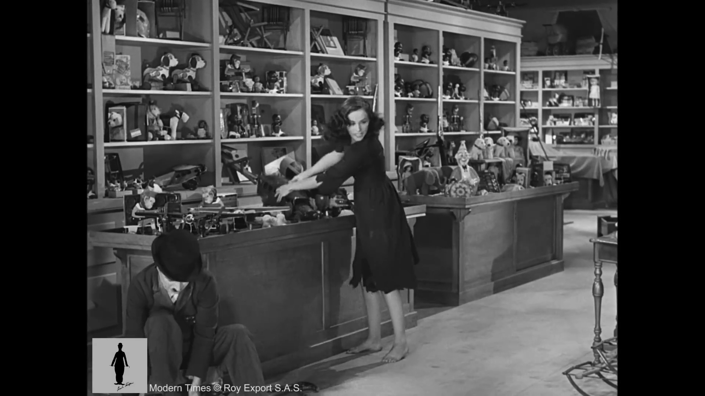
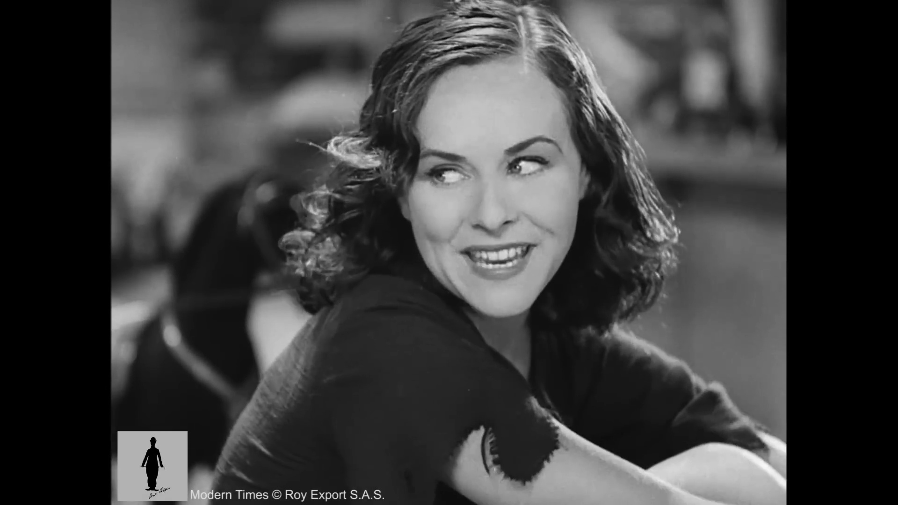
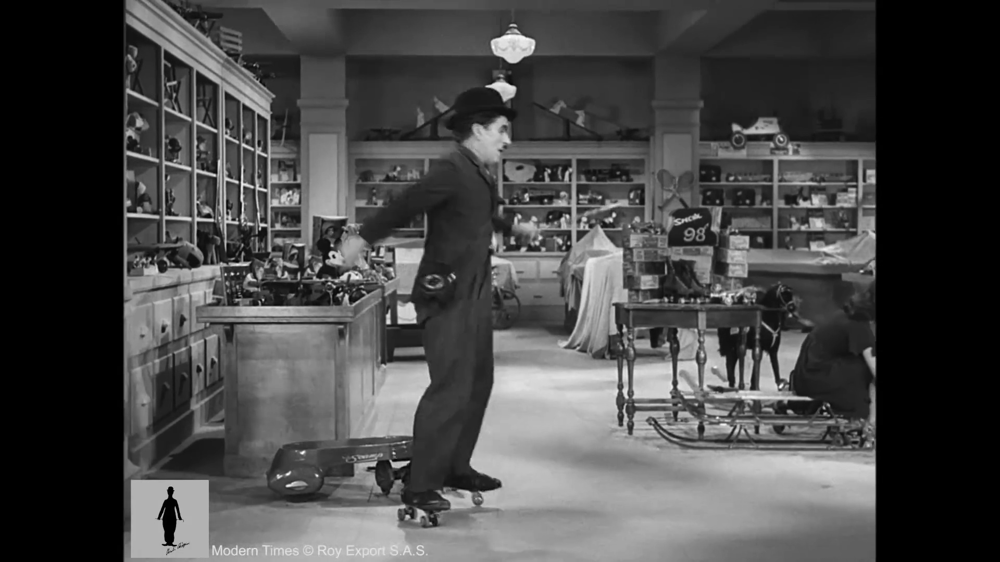
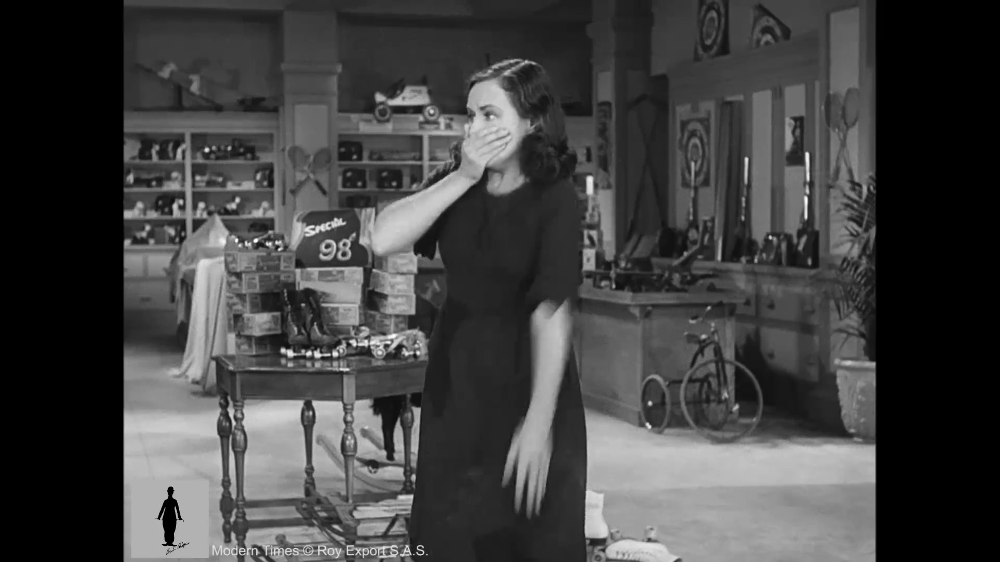
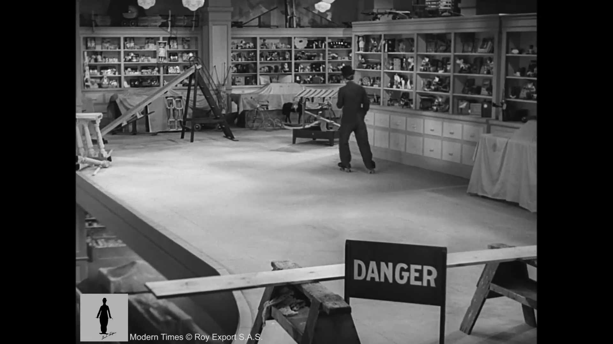
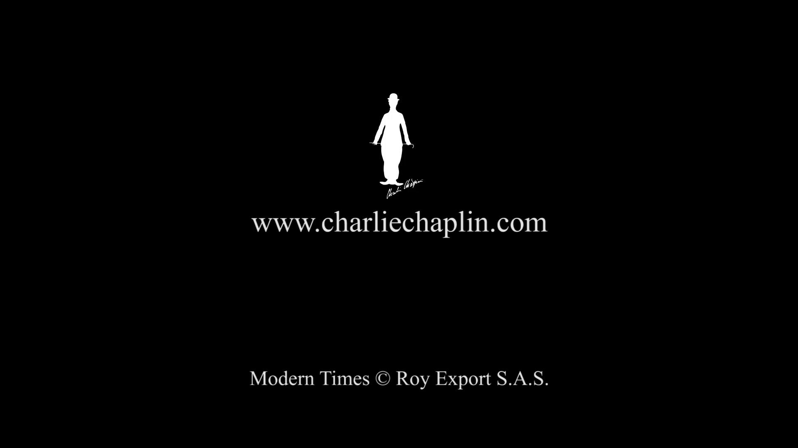

# Roller Skating SNL Sketch — Shot List

## Look Bible (locked — identical across every shot)
- **Style:** modern SNL live-sketch, digital video, single-camera studio sitcom look
- **Lighting:** flat even studio lighting, three-point setup
- **Grain/Grade:** clean digital broadcast video, slight sharpening, no film grain
- **Genre mode:** comedy

## Reference Sheet

| Ref ID | Tag | Description | Image | Restyle Status |
|---|---|---|---|---|
| set_office_floor | set | Establishing wide of the empty open-plan office floor before the chaos starts |  | pending_manual |
| coworker_ref | character | Sarah from HR skating backward, laughing, playful energy |  | pending_manual |
| intern_ref | character | Kevin the intern rollerblading with AirPods in, mid-spin, not looking |  | pending_manual |
| coworker_alarmed_ref | character | Sarah gasping, hand over mouth, pointing in horror |  | pending_manual |
| danger_sign_ref | prop | Wide shot of the unfinished floor edge with a DANGER sign and missing railing tape |  | pending_manual |
| intern_edge_ref | character | Kevin teetering at the very edge, arms out for balance, oblivious |  | pending_manual |

## Shots

### Shot 001 — Cold open - the empty office floor


- **Anchor:** set_office_floor
- **Shot type:** wide
- **Camera:** static
- **Action:** A cluttered open-plan tech office floor lined with product displays and rolling desk chairs, completely empty
- **Beat before gag:** long static hold on the empty floor before anyone enters, letting the space register as ordinary
- **Character count:** 0
- **Suggested tool:** Veo 3 (wide/establishing realism)

**Generation prompt:**
```
wide of A cluttered open-plan tech office floor lined with product displays and rolling desk chairs, completely empty, long static hold on the empty floor before anyone enters, letting the space register as ordinary, static, flat even studio lighting, three-point setup, clean digital broadcast video, slight sharpening, no film grain, modern SNL live-sketch, digital video, single-camera studio sitcom look
```

---

### Shot 002 — Coworker glides in, all confidence


- **Anchor:** coworker_ref
- **Shot type:** medium
- **Camera:** handheld
- **Action:** Sarah from HR rollerblades backward across the office floor, laughing over her shoulder at someone off-camera
- **Character count:** 1
- **Suggested tool:** Seedance 2.0 (character-lock consistency, main workhorse)

**Generation prompt:**
```
medium of Sarah from HR rollerblades backward across the office floor, laughing over her shoulder at someone off-camera, handheld, flat even studio lighting, three-point setup, clean digital broadcast video, slight sharpening, no film grain, modern SNL live-sketch, digital video, single-camera studio sitcom look
```

---

### Shot 003 — The intern joins in, oblivious and on a call


- **Anchor:** intern_ref
- **Shot type:** medium
- **Camera:** slow push-in
- **Action:** New intern Kevin skates in on rollerblades, AirPods in, deep in a work call, doing a little spin without looking where he's going
- **Character count:** 1
- **Suggested tool:** Seedance 2.0 (character-lock consistency, main workhorse)

**Generation prompt:**
```
medium of New intern Kevin skates in on rollerblades, AirPods in, deep in a work call, doing a little spin without looking where he's going, slow push-in, flat even studio lighting, three-point setup, clean digital broadcast video, slight sharpening, no film grain, modern SNL live-sketch, digital video, single-camera studio sitcom look
```

---

### Shot 004 — Sarah clocks the danger


- **Anchor:** coworker_alarmed_ref
- **Shot type:** medium
- **Camera:** static
- **Action:** Sarah's smile drops as she spots Kevin drifting toward the unmarked construction zone behind him
- **Beat before gag:** holds on her frozen half-smile for a beat before the alarm fully registers on her face
- **Character count:** 1
- **Suggested tool:** Seedance 2.0 (character-lock consistency, main workhorse)

**Generation prompt:**
```
medium of Sarah's smile drops as she spots Kevin drifting toward the unmarked construction zone behind him, holds on her frozen half-smile for a beat before the alarm fully registers on her face, static, flat even studio lighting, three-point setup, clean digital broadcast video, slight sharpening, no film grain, modern SNL live-sketch, digital video, single-camera studio sitcom look
```

---

### Shot 005 — Sarah reacts in horror


- **Anchor:** coworker_alarmed_ref
- **Shot type:** close-up
- **Camera:** static
- **Action:** Sarah claps a hand over her mouth, eyes wide, pointing frantically toward Kevin
- **Character count:** 1
- **Suggested tool:** Seedance 2.0 (character-lock consistency, main workhorse)

**Generation prompt:**
```
close-up of Sarah claps a hand over her mouth, eyes wide, pointing frantically toward Kevin, static, flat even studio lighting, three-point setup, clean digital broadcast video, slight sharpening, no film grain, modern SNL live-sketch, digital video, single-camera studio sitcom look
```

---

### Shot 006 — Kevin skates the edge, totally unaware


- **Anchor:** danger_sign_ref
- **Shot type:** wide
- **Camera:** locked-off
- **Action:** Kevin rolls calmly along the exposed ledge of the unfinished renovation zone, right past a DANGER floor-ends sign, still talking into his AirPods about quarterly numbers
- **Beat before gag:** let him coast for a full beat right at the edge before continuing, milking the obliviousness
- **Character count:** 1
- **Suggested tool:** Veo 3 (wide/establishing realism)

**Generation prompt:**
```
wide of Kevin rolls calmly along the exposed ledge of the unfinished renovation zone, right past a DANGER floor-ends sign, still talking into his AirPods about quarterly numbers, let him coast for a full beat right at the edge before continuing, milking the obliviousness, locked-off, flat even studio lighting, three-point setup, clean digital broadcast video, slight sharpening, no film grain, modern SNL live-sketch, digital video, single-camera studio sitcom look
```

---

### Shot 007 — The near-miss recovery


- **Anchor:** intern_edge_ref
- **Shot type:** wide
- **Camera:** static
- **Action:** Kevin's rollerblades teeter right at the drop-off, arms pinwheeling for balance for a split second, then he casually rolls back to safety without ever noticing, already laughing at something on his call
- **Character count:** 1
- **Suggested tool:** Veo 3 (wide/establishing realism)

**Generation prompt:**
```
wide of Kevin's rollerblades teeter right at the drop-off, arms pinwheeling for balance for a split second, then he casually rolls back to safety without ever noticing, already laughing at something on his call, static, flat even studio lighting, three-point setup, clean digital broadcast video, slight sharpening, no film grain, modern SNL live-sketch, digital video, single-camera studio sitcom look
```

---
